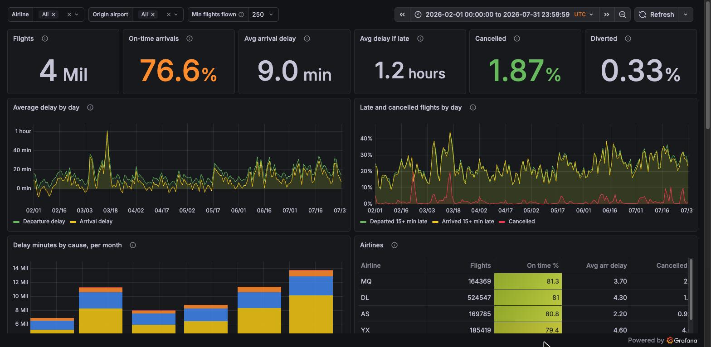
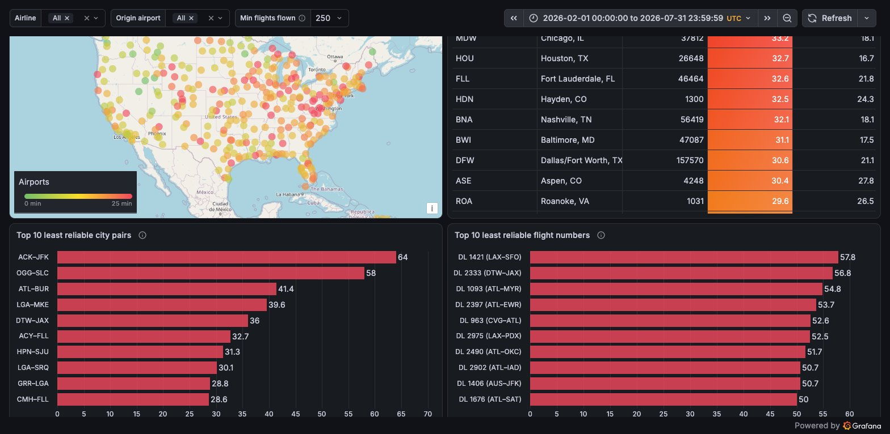
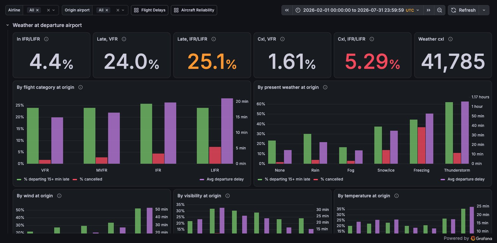
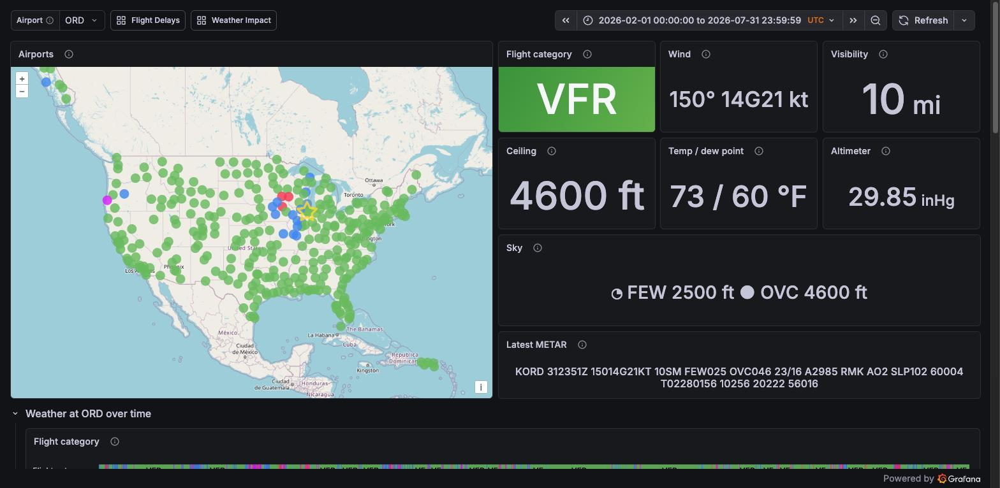
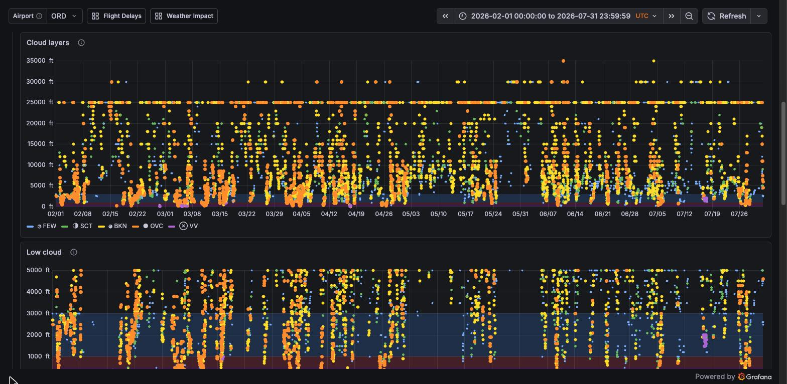
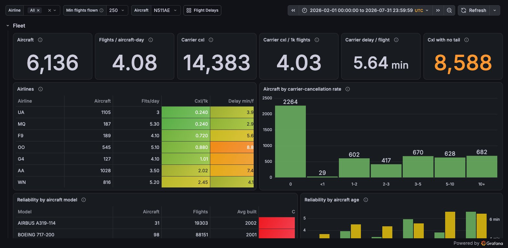
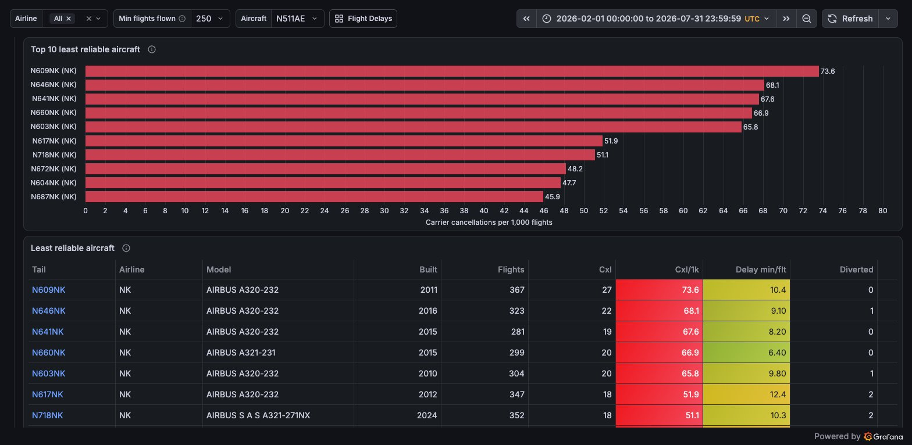
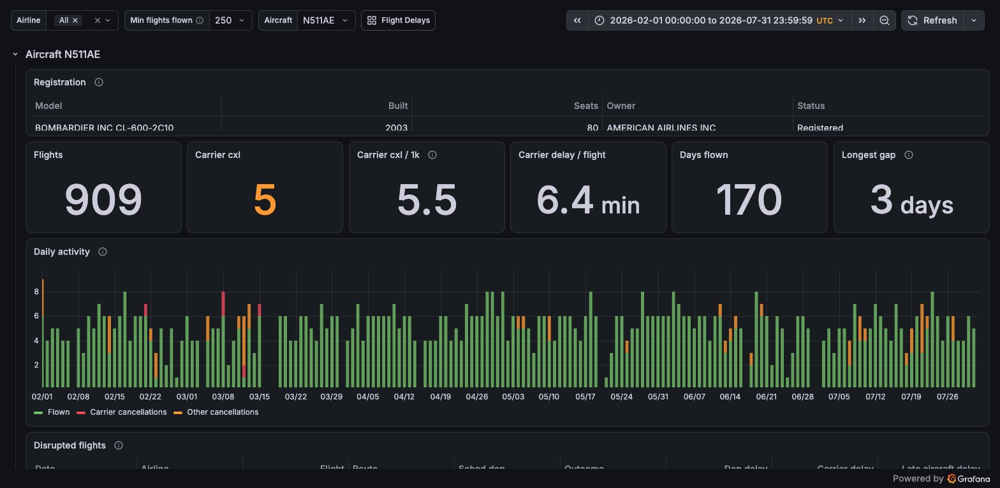

# databricks-faadata-demo
A Databricks / Grafana application that uses publicly available FAA flight and weather data.
It is a port of [clickhouse-faadata-demo](https://github.com/srmadscience/clickhouse-faadata-demo)
to Databricks: the same data, tables and dashboards. [How it differs](docs/clickhouse-vs-databricks.md)
goes through every change.

* **Databricks**: a SQL warehouse, with the tables in schema `faa` of a Unity Catalog catalog.
  [Free Edition](https://www.databricks.com/learn/free-edition) is enough.
* **Loader**: Java 21 / Maven, the Databricks JDBC driver, and the Files API for uploads
* **Scripts**: bash and Python 3 (standard library only), on the SQL Statement Execution API
* **Dashboards**: Grafana with the community [Databricks plugin](https://github.com/mullerpeter/databricks-grafana)
  (`mullerpeter-databricks-datasource`)

Developed with Databricks SQL 2026.39 (Free Edition, serverless) and Grafana 13.2.

## Data

| Table | Source | Grain |
|-------|--------|-------|
| `faa.ontime` | [BTS on-time performance](https://www.transtats.bts.gov/) | one row per scheduled flight; times are airport-local |
| `faa.stations` | [IEM](https://mesonet.agron.iastate.edu/) ASOS station metadata | one row per weather station, incl. time zone |
| `faa.weather` | [IEM ASOS](https://mesonet.agron.iastate.edu/request/download.phtml) observations | one row per METAR (roughly hourly), UTC; `faa.weather_load` is its staging table |
| `faa.airports` | [OurAirports](https://ourairports.com/data/) | one row per airport worldwide: codes, names, coordinates |
| `faa.airport_station` (view) | | BTS airport code → IEM station and time zone |
| `faa.registry_master`, `faa.registry_dereg`, `faa.registry_models` | [FAA aircraft registry](https://www.faa.gov/licenses_certificates/aircraft_certification/aircraft_registry/releasable_aircraft_download) | registered and deregistered aircraft; make/model reference |
| `faa.aircraft` (view), `faa.aircraft_info` (snapshot) | | one row per tail number: model, year built, seats, owner, status |
| `faa.tail_day` | built from `ontime` | one row per aircraft per airline per day: flights, cancellations, carrier delay (for the Aircraft Reliability dashboard) |
| `faa.flight_weather` | built from `ontime` + `weather` | one row per flight with UTC schedule times and the weather (flight category, wind, visibility, present weather) at origin and destination |

To join flights to weather, go through `faa.airport_station`: `ontime.Origin = airport`,
`weather.station = station`. Station ids differ from BTS codes outside the lower 48
(FAI → PAFA, SJU → TJSJ), and `sql/35_airport_aliases.sql` covers re-coded airports
(PBI → DJT) and closed ones (ISN, Williston, closed 2019). Saipan (SPN) has no IEM station.

Flights join to aircraft on `ontime.tail = aircraft_info.tail` (99.9% of 2025 tail numbers
match; aircraft retired since come from the deregistration file). Owner street addresses
are never loaded, and owner names only for organisations, not individuals.

## Layout

    src/main/java/...      Loader: ping | schema | load (converts CSV / .gz / .zip, uploads, INSERTs) | bench (query timing)
    sql/                   Schema, volume, tables and views, run in file-name order
    scripts/               Everything needed to rebuild the database and Grafana (below)
    aws/                   CloudFormation template for a Grafana demo server (below)
    grafana/provisioning/  Datasource + dashboard provider config
    grafana/dashboards/    Exported dashboard JSON (committed)
    data/                  Downloaded data: NOT in git (see data/README.md)
    docs/                  How this differs from the ClickHouse version; screenshots

## Reproducing the database

Needs bash, curl, python3, Java 21 and Maven, and a Databricks workspace with:

* a **SQL warehouse** (Free Edition has one, "Serverless Starter Warehouse"),
* a **catalog** in which you can create a schema (`main` by default; on Free Edition,
  `workspace`),
* a **personal access token**: Settings > Developer > Access tokens > Generate new token.

Then:

    cp databricks.properties.example databricks.properties   # set host, token, warehouse ID, catalog
    scripts/reproduce.sh 2025-01 2025-12

`databricks.properties` is git-ignored, so the token stays out of the repository. The
`DATABRICKS_HOST`, `DATABRICKS_TOKEN`, `DATABRICKS_WAREHOUSE_ID` and `DATABRICKS_CATALOG`
environment variables override it. The warehouse can be given as its ID or its whole HTTP
path (`/sql/1.0/warehouses/<id>`).

`reproduce.sh` runs these steps in order. Each is safe to re-run, and can be run on its own:

| Script | Does |
|--------|------|
| `create-database.sh` | Creates schema `faa`, its staging volume, and the tables and views from `sql/` |
| `fetch-flights.sh FROM TO` | Downloads BTS months (`YYYY-MM`) not already in `data/raw/flights/` |
| `load-flights.sh` | Loads them, replacing those months (`INSERT ... REPLACE WHERE`), then clusters `ontime` |
| `build-tail-day.sh` | Rebuilds `tail_day`; re-run after loading flights |
| `fetch-stations.sh` / `load-stations.sh` | Gets IEM stations and OurAirports; lists airports with no station |
| `fetch-weather.sh FROM TO` | Downloads IEM observations (years) for every airport in `faa.ontime` |
| `load-weather.sh` | Loads them into `weather_load` and `MERGE`s them into `weather`, without duplicates |
| `build-flight-weather.sh` | Rebuilds `flight_weather`; re-run after loading flights, stations or weather |
| `fetch-registry.sh` / `load-registry.sh` | Gets the FAA registry; replaces the registry tables and `aircraft_info` |

The fetch scripts download from the project's [data mirror](#data-mirror) first and go
to the original sources only for what it lacks, so a full rebuild takes minutes, not hours.
The load scripts load everything downloaded, which can be more than the range given.

To add more data later, run `reproduce.sh` with a wider range: existing downloads are skipped.
New months come from BTS if the mirror doesn't have them yet. To bring the current year's
weather, the station list or the registry up to date, use `--refresh`:

    scripts/fetch-weather.sh --refresh 2026 2026
    scripts/fetch-stations.sh --refresh
    scripts/fetch-registry.sh --refresh

### How loading works

Databricks reads files rather than streams of rows, so the Java loader converts each
downloaded file to gzipped CSV in the table's column order, uploads it to the volume
`faa.staging` (8 files at a time for the flights), and then runs one `INSERT ...
SELECT FROM read_files(...)` over all of them, and deletes them. Each load therefore
changes its table once, atomically: a load that fails, or is interrupted, leaves the table
as it was, and the staged files are deleted either way.

### Load times

A full load of January 2016 to July 2026, timed in October 2026 from an Apple M2 Mac
(16 GB RAM) at home to a Free Edition workspace (serverless SQL warehouse, on AWS). The
files were already downloaded, so the fetch steps only checked them; downloading them from
the [data mirror](#data-mirror) took about 10 minutes more at home when the ClickHouse
version was timed.

| Step | Time |
|------|-----:|
| `create-database.sh` | 22 s |
| `fetch-flights.sh 2016-01 2026-07` (127 months, already downloaded) | 2 s |
| `load-flights.sh` (68.4 million flights) | 22 min 56 s |
| `build-tail-day.sh` | 27 s |
| `fetch-stations.sh` / `load-stations.sh` | 31 s |
| `fetch-weather.sh 2016 2026` (11 years, already downloaded) | 42 s |
| `load-weather.sh` (42.2 million reports) | 12 min 21 s |
| `build-flight-weather.sh` | 3 min 52 s |
| `fetch-registry.sh` / `load-registry.sh` | 1 min 1 s |
| **Total** | **42 min 15 s** |

Most of that is the loader converting and uploading files from home: 18 minutes for the
flights (5.6 GB gzipped) and 10 minutes for the weather. The warehouse's own work is quick:
the single `INSERT` of all 68.4 million flights took 2 min 24 s, and `OPTIMIZE` about as
long again; the weather's `MERGE` and `OPTIMIZE` together took about 2.5 minutes, and
`build-flight-weather.sh`, which matches every flight to the weather at both ends, under 4.

The tables hold the same rows as ClickHouse's: 68,382,309 flights, 42,207,627 weather
reports, 68,379,354 flights with weather (all but Saipan's) and 16,666,847 aircraft-days,
and 8,841 of the 9,621 tail numbers flown since 2016 are identified in the registry (99.9%
of those flown in 2025). Delta stores them in 5.9 GiB: `ontime` 2.2 GiB, `flight_weather`
1.9 GiB and `weather` 1.7 GiB. Each load's timings are in
[`testresults_load.csv`](testresults_load.csv).

To time a load from scratch, drop the schema (`DROP SCHEMA faa CASCADE`) and move the
downloaded files out of `data/raw/`, then run:

    scripts/reproduce.sh --time "what changed since the last test" 2016-01 2026-07

This appends each step's time to [`testresults_load.csv`](testresults_load.csv), with the date, git commit,
Databricks SQL version and the comment, so runs can be compared.

## Query performance

`scripts/bench-queries.sh` runs randomly generated queries against the loaded database,
many at once, and times each one until its last row has been read. So far there is one
workload. `flight-history` fetches every flight of one aircraft, picked at random from
those that have flown, between two random dates 1 day to 10 years apart. The length of the
range is spread evenly on a log scale, so days, weeks, months and years are equally likely.

    scripts/bench-queries.sh flight-history --threads 8 --duration 60     # as fast as possible
    scripts/bench-queries.sh flight-history --rate 5 --duration 60        # 5 queries a second

- **Without `--rate`**, each of the threads runs queries back to back. This measures the
  most the warehouse can do for one client.
- **With `--rate`**, queries start on schedule, whatever happened to the earlier ones.
  Each query is timed from when it was due to start, so when the warehouse falls behind,
  the latencies grow instead of the rate quietly dropping.

Each thread has its own JDBC connection, opened before the test starts, and the result
cache is off, so every query really runs. The results are latency percentiles, overall
and by length of range. `--log FILE` writes one line per query, and `--seed N` repeats an
earlier run's queries. Add `--time "what changed"` before the workload to append a summary
to `testresults_query.csv`, as `reproduce.sh` does for loads.

A first test on the one month loaded, 8 threads for 20 seconds, managed 5.2 queries a
second, at a p50 of 1.5 s and a p99 of 2.8 s. `ontime` is clustered by `tail` and
`FlightDate`, so a query reads only the files that can hold that aircraft's flights.

## Data mirror

The original sources are slow (IEM weather alone takes about 10 hours at one request at a
time), so the raw files are also published as [GitHub Releases](https://github.com/srmadscience/clickhouse-faadata-demo/releases)
on the ClickHouse version of this project, which loads the same files: public, free to
download, and outside git itself.

| Release | Files |
|---------|-------|
| `data-flights` | `ontime_YYYY_MM.zip`, as downloaded from BTS |
| `data-weather` | `weather_YYYY.tar`: that year's `YYYY/STATION.csv.gz` files |
| `data-reference` | `stations.tar.gz` (IEM networks and OurAirports), `ReleasableAircraft_YYYYMMDD.zip` |

GitHub shows each file's SHA-256 and the fetch scripts check it. `DATA_REPO=owner/repo`
points them at another repository's releases instead, and `DATA_REPO=none` skips the mirror.

If you already have the files, for example in a clone of clickhouse-faadata-demo, link to
them instead of downloading them again; the scripts and the loader follow the links:

    src=$(cd ../clickhouse-faadata-demo/data/raw && pwd)
    for k in flights registry stations weather; do ln -s "$src/$k"/* data/raw/$k/; done

After fetching new data, update the mirror with:

    scripts/publish-data.sh              # DRY_RUN=1 to see what it would upload

It uses the `gh` CLI and uploads only files that are new or changed. The weather data
comes from the Iowa Environmental Mesonet, which asks to be credited; the other sources
are public domain.

## Grafana

Grafana queries Databricks through the community Databricks plugin,
[mullerpeter-databricks-datasource](https://github.com/mullerpeter/databricks-grafana). It
uses the same SQL warehouse, catalog and token as the scripts. The plugin is unsigned, so
Grafana loads it only if `grafana.ini` allows it.

**Automatic setup** works for a Grafana installed from the Linux packages (configuration in
`/etc/grafana`, run by systemd as `grafana-server`) on a machine you can SSH into with a key
and passwordless sudo. Add to `databricks.properties`:

    grafana.ssh=user@grafana-host

then run, now and after changing anything in `grafana/`:

    scripts/grafana-provision.sh

This installs the plugin if it is missing (v1.3.8) and adds it to
`allow_loading_unsigned_plugins` in `grafana.ini`; installs the datasource and dashboard
provider from `grafana/provisioning/`; copies `grafana/dashboards/*.json`, with their
catalog set to `databricks.catalog`; puts the token in a root-only
`/etc/grafana/faa-databricks.env`; restarts Grafana and prints the dashboard links. The
datasource is "Databricks FAA" (uid `databricks-faa`); being provisioned, it is read-only
in the UI.

**Any other Grafana** (Docker, Windows): install the plugin and allow it as unsigned (for
Docker, `GF_PLUGINS_ALLOW_LOADING_UNSIGNED_PLUGINS=mullerpeter-databricks-datasource`). In
Connections > Data sources, add a Databricks data source with uid `databricks-faa`, your
workspace host name, the warehouse's HTTP path and your token. The uid must match, because
the dashboards refer to it. Then import each file in `grafana/dashboards/` with Dashboards >
New > Import, and in each dashboard's settings set the hidden variable `catalog` to your
catalog, if it isn't `main`. Grafana Cloud doesn't allow unsigned plugins.

Dashboards (folder "FAA"):

| Dashboard | Shows |
|-----------|-------|
| Flight Delays (`/d/faa-flight-delays`) | On-time %, delays and cancellations over time, delay causes, airlines, hour/weekday patterns, airport map; top 10 least reliable city pairs and flight numbers |
| Weather Impact (`/d/faa-weather-impact`) | Delays, cancellations and diversions by weather at origin and destination: flight category, present weather, wind, visibility, temperature; worst weather days |
| Airport Weather (`/d/faa-airport-weather`) | Pick an airport on a map coloured by flight category, then see its observed weather (METARs) over time: flight category, the four cloud layers' cover and height, visibility, present weather, wind, temperature and dew point, precipitation and pressure, and the raw reports |
| Aircraft Reliability (`/d/faa-aircraft-reliability`) | Per tail number: carrier-caused cancellations and delays, utilisation, out-of-service gaps, reliability by model and age, top 10 least reliable aircraft; drill into one aircraft: its registration, daily activity, disrupted flights and full flight history |

The top-10 charts rank by carrier cancellations (cancellation code A) per 1,000 flights,
so weather and air-traffic cancellations don't count against an airline, and only consider
aircraft, city pairs or flight numbers with at least "Min flights flown" completed flights
in the time range.

### Screenshots

These show the ClickHouse version, with ten years loaded; the dashboards are the same, and
will be retaken on Databricks once the full data set is loaded here.

**Flight Delays**, February to July 2026: headline figures, delays and cancellations by
day, delay causes by month and the airline table (top, above); further down, the airport
map, the most delayed airports and the least reliable city pairs and flight numbers:

**Weather Impact**, February to July 2026: how late departures, cancellations and delays
vary with the weather at the departure airport:

**Airport Weather**, Chicago O'Hare, February to July 2026: airports coloured by flight
category at their latest report, that report decoded, and the flight category over time:

Its cloud layers over the six months, coloured by cover, over the full height and below
5,000 ft, where the shaded bands show the flight category a ceiling at that height gives:
MVFR up to 3,000 ft, IFR below 1,000 ft and LIFR below 500 ft:

**Aircraft Reliability**, February to July 2026: the fleet overview, the least reliable
aircraft (all ten flown by Spirit), and one aircraft's history (N511AE, a PSA Airlines CRJ-700):

To add a dashboard: build it in Grafana, export it as JSON (Share > Export), save it in
`grafana/dashboards/`, commit, and re-run the script.

## Running on AWS

[`aws/faa-demo.yaml`](aws/faa-demo.yaml) is a CloudFormation template that builds a demo
server for an existing workspace on one EC2 instance (Ubuntu 24.04, m7i.large by default) in
a new VPC, with only ports 22 (SSH) and 3000 (Grafana) open. The instance runs Grafana, with
the plugin and the FAA dashboards, and this repository; the tables stay in Databricks.

    aws cloudformation create-stack --stack-name faa-demo \
      --template-body file://aws/faa-demo.yaml --capabilities CAPABILITY_IAM \
      --parameters ParameterKey=KeyName,ParameterValue=my-key \
                   ParameterKey=AllowedCidr,ParameterValue=$(curl -s https://checkip.amazonaws.com)/32 \
                   ParameterKey=DatabricksHost,ParameterValue=dbc-xxxxxxxx-xxxx.cloud.databricks.com \
                   ParameterKey=DatabricksWarehouseId,ParameterValue=1234567890abcdef \
                   ParameterKey=DatabricksCatalog,ParameterValue=workspace \
                   ParameterKey=DatabricksToken,ParameterValue=dapi...
    aws cloudformation describe-stacks --stack-name faa-demo --query 'Stacks[0].Outputs'

The token is kept in an AWS Secrets Manager secret that only the instance's role can read,
not in the instance's user data. Grafana's user is `admin`, with the password in the
`GrafanaPassword` parameter (default `hiredavid`). `AllowedCidr` defaults to anywhere, so
set it to your own address. Nothing is loaded unless `LoadFrom` (and `LoadTo`) say so, as
the workspace may have the data already; loading from the instance is faster than from home
if the workspace is in the same region. The instance clones the repository and runs
[`scripts/install-server.sh`](scripts/install-server.sh), which works on any fresh Ubuntu
24.04 machine; follow its progress in `/var/log/faa-setup.log`. Delete the stack to remove
everything but the data in Databricks.

## Large data files

The data does not live in git: the repo holds the *recipe* (the scripts above),
the [data mirror](#data-mirror) holds a copy of the files, and `data/manifest.sha256`
can record checksums of exactly what was loaded.
